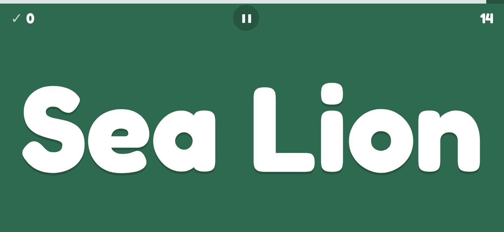
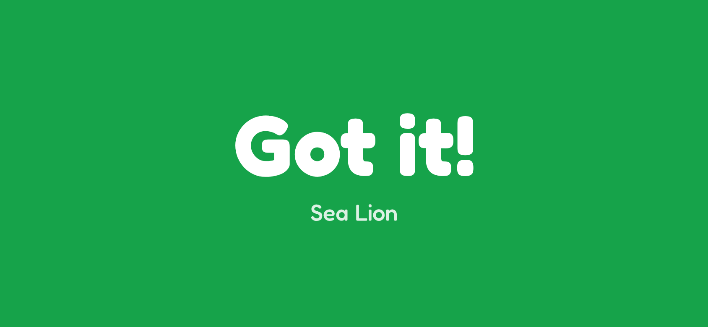
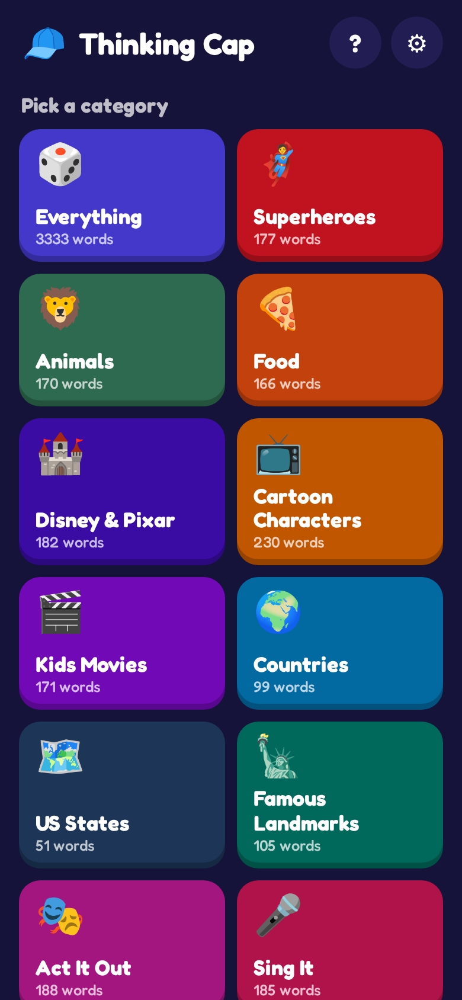
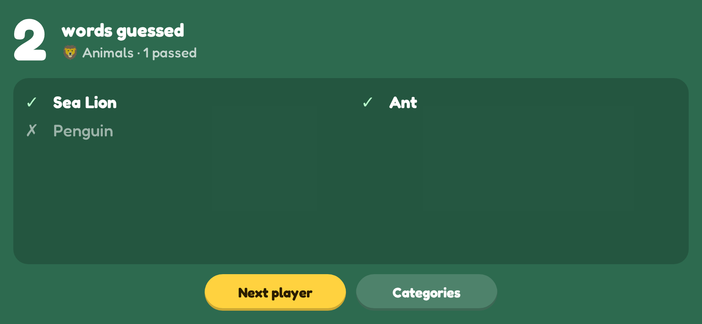

# Thinking Cap 🧢

A free, open-source forehead guessing game for family game night. One person
holds the phone to their forehead, everyone else describes the word on the
screen, and the guesser tilts the phone to score or pass.

No ads, no accounts, no "premium" decks. Every word list is a plain text file
in this repo, and you can type in or import your own decks.

**Status:** early prototype. The game works end to end; the word lists are a
first draft and need a family-game-night playtest.

<p>
  
  
</p>
<p>
  
  
</p>

## Play it

- **Android app:** [download thinking-cap.apk](https://github.com/false-leads/thinking-cap/releases/download/latest-build/thinking-cap.apk)
  on your phone, open it, and allow installs from your browser when Android
  asks. Every push to `main` rebuilds it, and new builds install over old ones.
- **Any phone's browser, including iPhone:** <https://false-leads.github.io/thinking-cap/>.
  Use *Add to Home Screen* and it runs full screen and works offline.

## How to play

1. Pick a category and how hard the words should be.
2. The guesser holds the phone sideways on their forehead, screen facing out.
3. Everyone else describes the word without saying it. In *Act It Out* you
   mime it, and in *Sing It* you hum.
4. **Tilt up** when you get it, **tilt down** to pass. You can swap these in
   Settings if your family prefers the other way round.
5. When time's up, read the list together and pass the phone on.

No tilt sensor (or a laptop)? Turn on *Use buttons instead of tilting* in
Settings, or use the ↑ / ↓ arrow keys.

## Categories

Every word is rated **easy** (a 5–7-year-old knows it), **medium** (an
8–12-year-old knows it) or **hard** (teens and adults, but still mainstream).
Choose which levels to play before each round.

| Category | Easy | Medium | Hard |
|---|---:|---:|---:|
| 🦸 Superheroes | 54 | 78 | 45 |
| 🦁 Animals | 60 | 60 | 50 |
| 🍕 Food | 59 | 58 | 49 |
| 🏰 Disney & Pixar | 59 | 72 | 51 |
| 📺 Cartoon Characters | 63 | 120 | 47 |
| 🎬 Kids Movies | 57 | 61 | 53 |
| 🌍 Countries | 23 | 38 | 38 |
| 🗺️ US States | 14 | 27 | 10 |
| 🗽 Famous Landmarks | 29 | 40 | 36 |
| 🎭 Act It Out | 59 | 74 | 55 |
| 🎤 Sing It | 57 | 62 | 66 |
| 🎮 Video Games | 52 | 93 | 45 |
| 📚 Storybook Characters | 62 | 85 | 40 |
| 🐉 Fairy Tales & Fantasy | 53 | 62 | 49 |
| 🧸 Toys & Games | 60 | 62 | 47 |
| 🎄 Holidays & Seasons | 70 | 123 | 52 |
| ⚽ Sports | 59 | 81 | 57 |
| 👷 Jobs | 53 | 69 | 52 |
| 🏠 Around the House | 59 | 59 | 49 |
| 🚗 Things That Go | 36 | 49 | 31 |

20 decks, 3333 words

Plus **Everything**, which mixes all of them and shows each word's category.
Words don't repeat between rounds until a category runs low.

## Make your own decks

In the app, tap **New deck** and type one word per line, or **Import file**
to load a `.txt` or `.json` file. Custom decks stay on that phone only, so
they're also the place for anything you don't want in a public repo (family
names, inside jokes).

Text format (headers are optional; words without one count as medium):

```text
# easy
Grandma
The Dog
# hard
Uncle Bob's Chili
```

JSON files use the same format as the built-in decks (below), and can hold
an array of decks to import several at once.

## Add or fix a built-in deck

Decks live in [`src/decks/`](src/decks), one JSON file each:

```json
{
  "id": "animals",
  "name": "Animals",
  "emoji": "🦁",
  "color": "#2d6a4f",
  "blurb": "Pets, farm, zoo, ocean and dinos",
  "hint": "Optional instruction shown under each word",
  "words": {
    "easy": ["Dog", "Cat"],
    "medium": ["Penguin"],
    "hard": ["Platypus"]
  }
}
```

Rules of thumb: family-friendly only; write words the way people say them;
"hard" should still be something most adults have heard of. The file name must
match `id`, and the color must keep white text readable. A new file shows up in
the app automatically (add its id to `ORDER` in `src/decks.ts` to place it).

Check your changes with:

```bash
node scripts/check-decks.mjs --stats
```

It catches duplicates (ignoring case and punctuation), missing fields, words
over 40 characters, and colors too pale for white text.

## Develop

```bash
npm install
npm run dev        # Vite dev server; open the Network URL on a phone on the same Wi-Fi
npm test           # unit tests: tilt detection, word picking, deck import, deck checker
npm run typecheck
npm run build      # production web build -> dist/
```

Motion sensors only work over HTTPS (or `localhost`), so a phone on your LAN
won't send tilt readings to the plain-HTTP dev server. Use the buttons there,
test tilting with the Android app, or put the dev server behind an HTTPS
tunnel. `?seconds=10` makes rounds short and `?deck=animals` opens a category
directly.

End-to-end test (plays whole rounds in Chromium with a fake accelerometer and
saves screenshots):

```bash
npm run build && npx vite preview --port 4173 &
node e2e/smoke.mjs http://localhost:4173/ screenshots/tmp
```

### Android

CI builds the APK, so you don't need Android tooling to contribute. To build
locally you need JDK 21 and the Android SDK (Android Studio is easiest):

```bash
npm run android:sync   # build web + copy into android/
npm run android:open   # open in Android Studio, then Run
```

The app icon and splash screen come from `scripts/make-icons.mjs` and
`npx @capacitor/assets generate --android`.

## How the tilt detection works

The game reads the accelerometer (`devicemotion`) and works out the angle
between the screen and vertical. Upright on the forehead is about 0°. Past
±40° (adjustable in Settings) counts as a tilt, and the phone has to come
back upright before the next tilt counts. It doesn't use the
`deviceorientation` angles, which jump around exactly at the upright position.
See [`src/tilt.ts`](src/tilt.ts). Settings has a live tilt tester for tuning on
a real phone.

## Layout

- `src/decks/*.json`: the word lists
- `src/tilt.ts`: tilt detection
- `src/picker.ts`, `src/history.ts`: which words come up, without repeats
- `src/customDecks.ts`: making, importing and storing your own decks
- `src/screens/`: home, ready, play, results, settings, deck editor, help
- `src/platform.ts`: motion permission, keep-awake, full screen, vibration
- `android/`: Capacitor Android shell (keeps the screen on, hides system bars)
- `scripts/check-decks.mjs`: deck checker (also run by the tests)
- `e2e/smoke.mjs`: end-to-end test

## License

[GPL-3.0-or-later](LICENSE). Anyone can use, change and share it, and
anything built from it has to stay open source too, so nobody can put these
decks behind a paywall.
